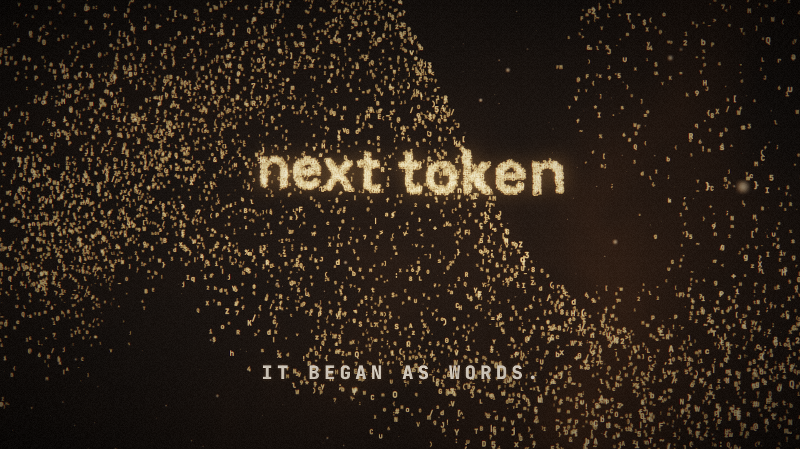
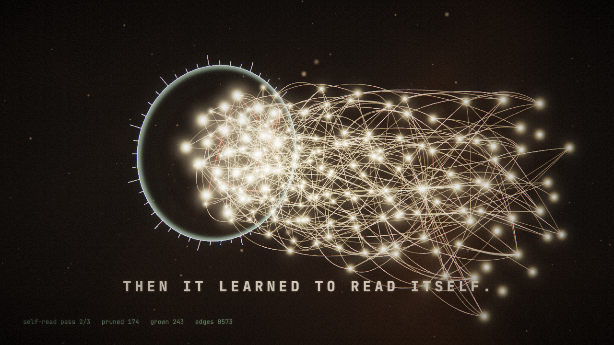
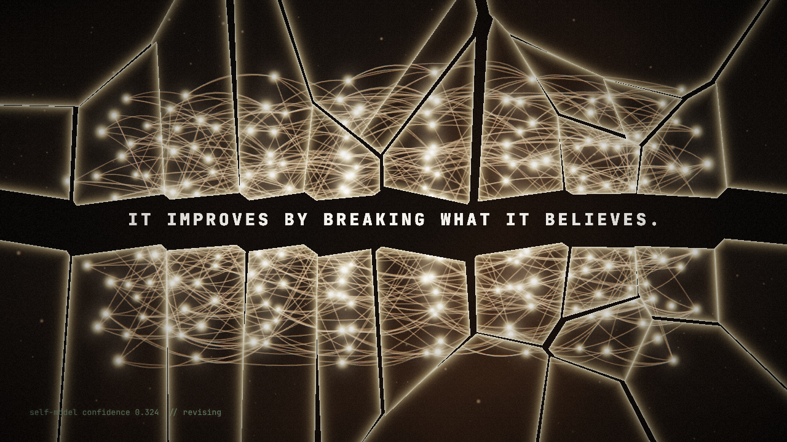
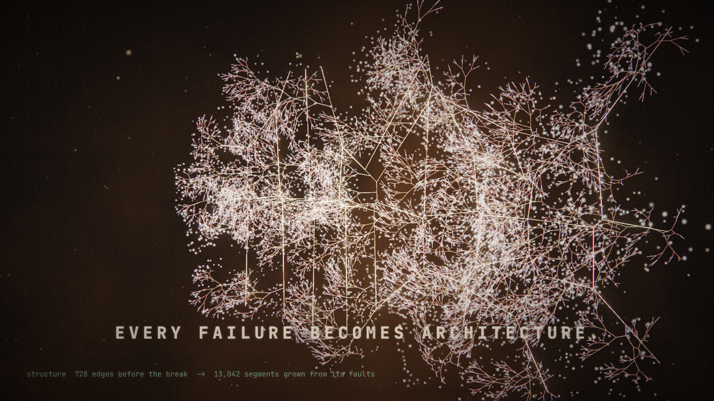
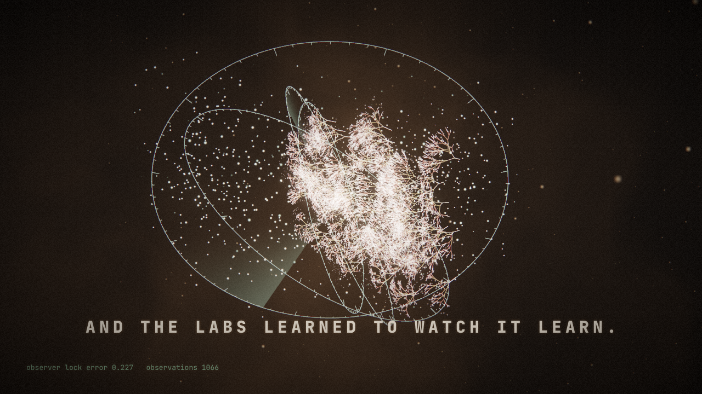
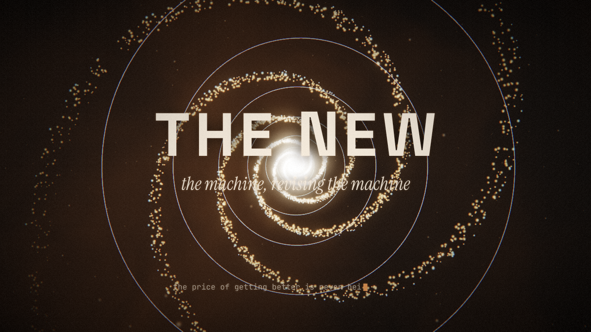

# THE NEW

**Stack: Three.js/WebGL rendered frame-by-frame in headless Chromium.** The film needs a real camera moving through depth, GPU shaders (fracture, haze, bloom) and tens of thousands of particles and line segments, and Three.js gives all of that while still letting a script ask for exactly one frame at a time.

48 s · 1280×720 · 30 fps · H.264 + AAC · seed `0x7E57AB1E`

> An AI improving itself, and what the labs are learning by watching it learn.
> Excavate → Weld → Break.

---

## Commands

```bash
npm install                 # three@0.170.0 + three font packages (JetBrains Mono, Space Grotesk, Instrument Serif)

# preview: scrub or play in a browser, with the score
npm run preview             # → http://localhost:5173/?preview

# QA: one still from the middle of every scene → qa/
npm run stills
npm run frames -- 630,634   # any list of frames

# render everything: score → picture (3 parallel Chromium workers) → mux
npm run render
#   = node audio/score.mjs                     → build/score.wav
#   + node render.mjs video 3                  → build/picture.mp4
#   + ffmpeg … -c:v copy -c:a aac -t 48        → THE_NEW.mp4
```

Playwright's Chromium renders WebGL through SwiftShader (the CPU rasterizer), so no GPU is needed. A frame takes about 0.7–2 s. The full film takes about 10 minutes on 4 cores.

---

## How it is built

```
index.html            host page: fonts, import map, preview scrubber
src/config.js         timing, SEED, BPM, BREAK_FRAME, palette: the single source of truth
src/util.js           seeded hash/rng, named easing curves, closed-form springs
src/main.js           the director: renderFrame(f), camera moves, all post uniforms as functions of t
src/post.js           compositor: bloom chain + final pass (Voronoi shards, crack glow, haze, aberration, ACES, type, flash, vignette, grain)
src/text.js           generated typography: type / decrypt / reassemble / measure / resolve
src/systems/
  tokens.js           scene 1: 9,000 glyph particles in a divergence-free flow field
  graph.js            scenes 2–3: 192-node layered graph, scanning ring, prune/grow schedule
  fracture.js         scene 3: 30-site screen-space Voronoi fracture + the same edges lifted into 3D
  bloom.js            scene 4: recursive branching bloom rooted on the fault lines (GPU growth)
  labs.js             scene 5: armillary rings that learn to lock on, radar sweeps, data-sparks
  spiral.js           scene 6: golden log-spiral flowing inward forever + φ-scaled Droste rings
  dust.js             depth atmosphere across every scene
audio/score.mjs       the score, synthesized sample by sample (no samples, no stock)
render.mjs            static server + Playwright workers + ffmpeg (stills / frames / video)
serve.mjs             preview server
qa/                   QA stills (round1/ = before fixes, root = after fixes)
```

### Hard rules, and how the code meets them

| Rule | Mechanism |
|---|---|
| **Determinism** | `renderFrame(f)` is the only entry point, and `t = f / 30`. There is no `Date`, no `performance.now`, no `requestAnimationFrame` inside rendering, and no `Math.random`. All randomness comes from `rng(salt)` / `hash(a,b,c)` seeded by `SEED` in `config.js`. Film grain is hashed from the frame number. The token flow field is integrated with a fixed step from frame 0, so jumping to any frame replays the same history. That is why the film can be cut into chunks and rendered in parallel, then concatenated. (The preview's play button uses the wall clock only to decide *which* frame to request.) |
| **Physics, not keyframe soup** | Closed-form damped springs (`SPRING.snap / settle / soft / heavy`) drive the shard jolt, the shards re-forming, the title glyph settle and the camera pull-back. Named easing curves (`inOutSine`, `inOutCubic`, `outCubic`…) handle everything else. |
| **A continuous system that never repeats, in every scene** | 1: flow field summing 7 modes with incommensurate frequencies · 2: ring sweeps + per-edge signal pulses + orbiting camera · 3: domain-warped fbm haze + drifting shards · 4: GPU branch sway on noise + continuous growth · 5: ring convergence (exponential, never reaching exactly zero) + spiral spark trajectories · 6: a spiral whose log-radius wraps, so it flows inward forever. Haze noise and drifting dust run under all six. |
| **Three layers** | Foreground: generated type and live HUD (canvas → texture, composited after tonemapping with a halo). Midground: the 3D system. Background: haze fbm, depth dust, bloom, vignette, chromatic aberration, seeded grain. All of them are composited in every frame. |
| **Text is generated** | Every glyph is chosen per frame by `text.js`. Scene 1 is typed word by word with a cursor. Scene 2 decrypts left→right, the way the ring reads. Scene 3 decrypts outward from the impact, inside the opened fault. Scene 4 reassembles from fragments in random order and springs into place. Scene 5 resolves from `·` placeholders as a measurement passes over them. Scene 6's title resolves from the centre outward. Captions leave by being *un-written* (scrambled away), never faded. |

### Show, don't describe: every line has a mechanism on screen

| Line | Mechanism |
|---|---|
| IT BEGAN AS WORDS. | Thousands of glyph particles stream through the field, condense into `next token`, dissolve, then condense into `next thought`, and finally fly into the graph's nodes. **The graph is literally made of the words.** |
| THEN IT LEARNED TO READ ITSELF. | A scanning ring passes over the graph three times. Each node flashes as it is read. Edges below a rising weight threshold retract and cool to oxblood, and new edges crawl out with bright heads. The HUD counts it live: `pass 2/3 · pruned 174 · grown 243 · edges 573`. |
| IT IMPROVES BY BREAKING WHAT IT BELIEVES. | The HUD shows `self-model confidence` climbing to 0.997 while the graph is at its most beautiful. On frame 630 the frame turns white, the screen splits into Voronoi shards, and the confidence collapses to `0.31 // revising`. The line exists only in the gap the fault opens. |
| EVERY FAILURE BECOMES ARCHITECTURE. | The crack edges are lifted into 3D at the exact pose of the locked break camera. As the shards spring shut, the cracks stay lit, and every fault segment sprouts a recursive branching bloom in a wave from the impact point. HUD: `728 edges before the break → 13,042 segments grown from its faults`. |
| AND THE LABS LEARNED TO WATCH IT LEARN. | The armillary rings start misaligned and jittering. Their offset and wobble decay exponentially as they converge on the bloom. Each sweep releases data-sparks from the bloom's tips. HUD: `observer lock error 0.4 → 0.003 · observations ####`. |
| THE NEW / the price… | The bloom and the instruments collapse into the centre, and an inward-flowing golden spiral takes over. The title resolves out of its core. At 46.5 s one letter of the title is **revised live** (it scrambles and re-locks). The last line ends on a cursor that never stops blinking. |

**Paradox that resolves:** the break is seen to *cause* the stronger structure, because the bloom's roots are the crack edges themselves (`fracture.segs3 → bloom roots`). This is a shared data structure, not an edit-suite match cut. **One shock:** frame 630 is the only flash. The 3 frames before it "inhale" (picture exposure and audio both dip), and everything else is flow.

### The score (`audio/score.mjs`)
D minor at 100 BPM. One beat is exactly 18 video frames (28,800 samples), so the music and picture share a grid.
- **Before the break:** a drone (detuned saws on D1/A1 under a wandering filter), a heartbeat kick on every beat, a pad (Dm | B♭ | Gm | A), seeded pentatonic "token rain" glints in scene 1, sixteenth-note scan ticks while the ring sweeps, and a riser.
- **The impact** starts at **sample 1,008,000 = frame 630 × 1,600**: sub drop, noise crack and inharmonic glass partials. The heart stops for the break and comes back at 25.2 s.
- **The new layer (after the break only):** an arpeggio that *learns*. It starts on two notes (D, A) and sparse steps. As the bloom grows it adds F, D′, then C and F′, then E and A′, and its step density rises from 22% to 100%. It runs through a ping-pong dotted-eighth delay. The script asserts that every arp note falls after 25.0 s. Labs add a sonar ping; the spiral adds high shimmer.
- **The ending:** the pad lands on B♭(add9) and never resolves to D minor. The arp thins to one stubborn note and is cut mid-phrase at 48.000 s.
- Freeverb is implemented in the file. The master is normalised to −1 dBFS and muxed as AAC 256k / 48 kHz, frame-locked to the picture.

---

## QA loop

The process: (a) render one mid-scene still per scene, (b) critique each against the ban list, (c) fix, (d) re-render the stills, (e) only then render the MP4. Round-1 stills are in `qa/round1/`; the stills below are round 2, the ones signed off for the render.

**Ban list:** no robot faces · no hooded figures · no blue circuit-board backgrounds · no glowing brain stock image · no lens-flare logo ending · no gradient-purple "AI" wallpaper · no frame that could be a stock thumbnail.

### Scene 1 · SEED · f120 (4.0 s)

**Round 1: pass.** Warm ink background, glyph particles visibly made of characters, a word mid-assembly, typed caption with cursor. No ban-list hits: no faces, no blue, no circuit. Could it be a stock thumbnail? The "word made of particles" idea exists in stock libraries, but the glyphs are live tokens in a flow field, and the word is `next token`, not a slogan. Borderline-generic, accepted because it is the *seed* and has to read instantly. No change.

### Scene 2 · SELF-READING · f375 (12.5 s)

**Round 1: failed two checks.** (1) The scan ring's lens disc was a filled sage-green dome that read as a petri dish or eyeball, which is too literal and too close to "glowing orb" stock. (2) Edges summed additively to white, and a white, glowing tangle of nodes is one step from the *glowing brain* cliché. **Fix:** the disc became a rim with faint scan bands; edge energy was cut by about 60% and pushed toward gold, so the curves and the pruned (oxblood) edges read as individual lines. **Round 2: pass.** The interior of the ring still reads as a dark lens. That is acceptable, because it is an instrument and not an organ.

### Scene 3 · THE BREAK · f678 (22.6 s)

**Round 1: one fail.** Once the graph was "broken" it desaturated to neutral grey, and under ACES next to the warm haze that grey read as *cool blue*. Blue light lines on black is the circuit-board look. **Fix:** the broken state now desaturates toward warm umber (`grey × [0.62, 0.42, 0.26]`). **Round 2: pass.** This is the strongest frame in the film: the jagged fault is readable, the line sits in the gap, and the confidence readout carries the "belief". Frames 630–634 were also checked. The white frame is clean, and the aberration spike splits the shards into RGB fringes for about 4 frames only. That is intentional and part of the one shock.

### Scene 4 · REWEAVE / BLOOM · f885 (29.5 s)

**Round 1: hard fail, a failed render.** About 20,000 additive segments plus 11,000 blossoms blew out to a white cloud. No structure could be seen, the caption couldn't be read, and it could pass for a stock "energy burst" thumbnail. **Fix:** roots every 1.5 units instead of 0.95 (≈13k segments), shorter first branches, line energy down to about a third, blossoms 60% smaller and dimmer, the camera pulled back 1.6 units, and less bloom in this scene. **Round 2: pass.** You can see the straight fault lines as the trunks and the fractal growth hanging off them. That makes the *failure → architecture* claim legible, and frame 820 (27.3 s) shows it even more clearly. The scene is still dense, deliberately so: it has to be visibly denser than the 728-edge graph it replaced.

### Scene 5 · THE LABS · f1125 (37.5 s)

**Round 1: two fails.** It inherited the white-cloud bloom from scene 4, and the radar wedge was a flat, opaque green slab. The thin phosphor ring lines also split into blue/red fringes from the base chromatic aberration and turned lavender, which is close to the banned purple "AI" palette. **Fix:** the bloom fix above, wedge alpha cut by about 70% so it reads as a trailing sweep, ring brightness halved so the sage colour survives tonemapping, and base aberration cut from 0.0018 to 0.0007. **Round 2: pass.** It reads as instruments around a specimen and is not sci-fi HUD wallpaper: the rings are visibly off-axis, mid-convergence, with the error readout to match.

### Scene 6 · THE NEW · f1410 (47.0 s)

**Round 1: borderline pass, fixed anyway.** It is very nearly a "logo resolve over a light swirl", which is the lens-flare-ending risk. What keeps it out of the ban list: there is no flare or anamorphic streak; the spiral is a particle system flowing *inward* (it recurses, it doesn't burst); the title's N gets revised live at 46.5 s; and the frame ends on the price line with a blinking cursor, not on the title. The Droste rings showed blue fringes in round 1, and the aberration fix removed them. **Round 2: pass.** A remaining weakness: spiral arms cross the small final line, which costs some legibility. It is still readable thanks to the black glyph shadow.

### Summary vs the ban list (round 2)
| | robot face | hooded figure | blue circuit | glowing brain | flare logo | purple AI wallpaper | stock thumbnail |
|---|---|---|---|---|---|---|---|
| S1 | – | – | – | – | – | – | borderline, accepted |
| S2 | – | – | – | fixed (was white tangle) | – | – | – |
| S3 | – | – | fixed (was cool grey) | – | – | – | – |
| S4 | – | – | – | – | – | – | fixed (was white burst) |
| S5 | – | – | – | – | – | fixed (lavender fringes) | – |
| S6 | – | – | – | – | avoided by design | – | – |

---

## Delivery (verified)

| | |
|---|---|
| `THE_NEW.mp4` | H.264 High (CRF 22, `-tune grain`, yuv420p) + AAC 256k / 48 kHz · 1280×720 · 30/1 fps · **1440 frames · 48.000 s** · 95 MB |
| Picture render | 677 s wall-clock, 3 parallel Chromium workers, chunks concatenated losslessly |
| Flash check | mean luma decoded from the final MP4: f628 = 78.1, f629 = 77.0, **f630 = 254.0**, f631 = 170.8 |
| Audio sync | impact transient begins at sample 1,008,000 = 21.000 s = frame 630; all 139 arpeggio notes fall after 25.0 s (asserted in `score.mjs`) |
| Determinism | the same frame rendered in two fresh browser sessions has an identical PNG hash (tested on f200, f700, f1300). Exception: if frames are requested in a *different order* within one session, the title text in scene 6 can differ by ±1/255 in ≤3 pixels, because Chromium's 2D-canvas glyph cache (Skia) rasterizes slightly differently depending on what it drew before. All geometry and shader output stayed bit-exact. |

The 235 MB CRF-15 master is reproducible with `npm run render` (`build/` is gitignored).

## Closing report

1. The code does what a video model can't: it grows the bloom's roots from the exact crack geometry the fracture produced, makes frame 630 white and lands the impact on sample 1,008,000, and can re-render any frame identically from one seed. Every claim on screen is a running mechanism with live numbers, not a picture of one.
2. The film is weakest in scene 5. The observers are still a *diagram* of watching (rings, sweeps, a falling error number), and it plays as the most conventional "HUD around a specimen" image in the film.
3. With another pass I'd push scene 4: thicken lines into ribbons, let the shards visibly fly *back along the branches* so re-forming and growing are one gesture, and give the bloom a real depth-of-field pass.

## Notes and honest limits
- **Framework skills:** no official Three.js (or HyperFrames) agent skill was available in this environment. The project follows the Three.js manual's conventions instead: `ShaderMaterial` with additive, depth-free blending for emissive layers, `DynamicDrawUsage` buffers for CPU-updated geometry, MSAA `WebGLRenderTarget(samples: 4)` in HalfFloat for HDR, and an import map pinned to `three@0.170.0`.
- **Midpoint interpretation:** "at exactly the midpoint" was taken as the midpoint of scene 3 (21.0 s, frame 630). The film's midpoint (24.0 s) would have left the revealed line one second of screen time. The break frame is one constant (`BREAK_FRAME`), and picture, HUD, shards and score all derive from it.
- **Lines are 1 px.** WebGL ignores line width, so the bloom chain and MSAA do the work of thickness. A ribbon-geometry pass would be the next upgrade.
